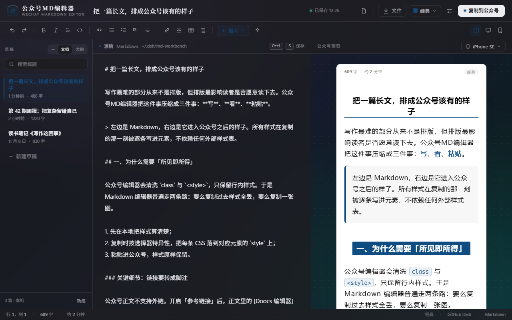
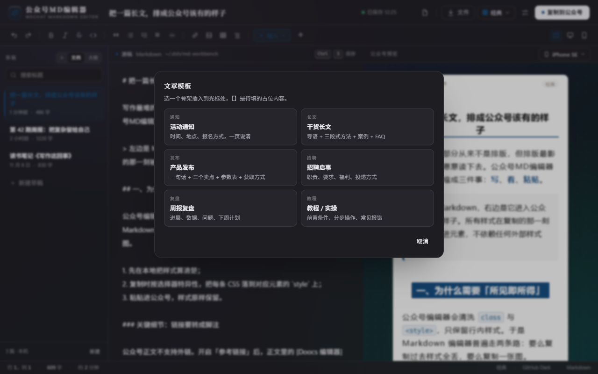
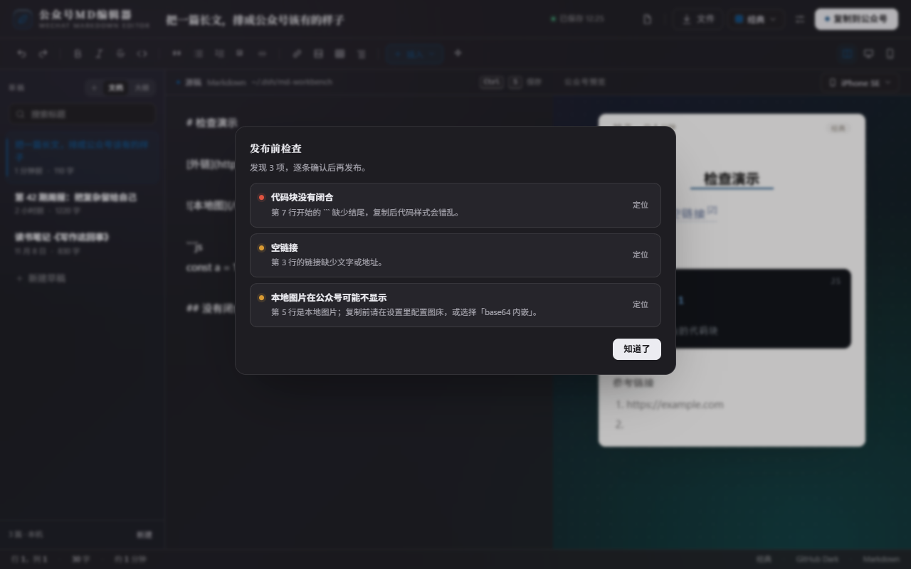
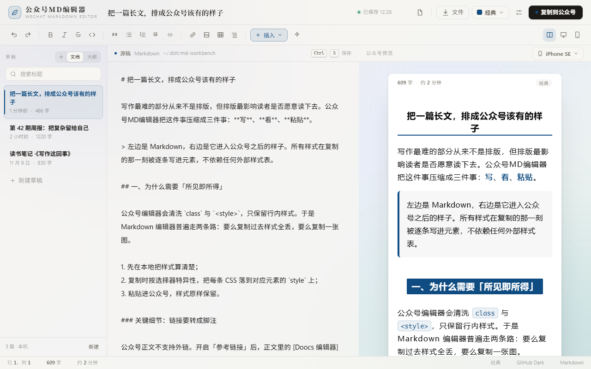

# 公众号MD编辑器 · WeChat Markdown Editor

> 原「墨台」。一个写给微信公众号作者的本地 Markdown 工作台：**左边写 Markdown，右边就是它进入公众号之后的样子**，点一下「复制到公众号」直接粘进后台。

[](LICENSE)




## 为什么是它

公众号编辑器只保留行内样式，会清理 `class` 与 `<style>`。常见做法要么复制过去样式全丢，要么干脆复制一张图。

公众号MD编辑器的做法：主题写成一份 CSS，预览时正常注入；复制时把这份 CSS **按选择器特异性逐条内联到每个元素**，公式、Mermaid 图表、二维码在复制前转成 PNG，再交给剪贴板。所见即所得，粘贴后不跑版。

## 功能

### 写作

- 自写 GFM 引擎：标题、粗斜体、删除线、行内代码、引用、有序 / 无序 / 任务列表、表格（对齐）、分割线、脚注、图片、链接、`[TOC]`、软换行
- 多草稿：自动保存、搜索、重命名、复制、删除
- 导入 `.md`、导出 `.md` / `.html`、复制源码
- 从 HTML 粘贴：网页、Word、公众号后台的富文本 → Markdown
- 6 套文章模板：活动通知 / 干货长文 / 产品发布 / 招聘启事 / 周报复盘 / 教程实操
- 快捷键：`Ctrl+B` / `Ctrl+I` / `Ctrl+K` / `Ctrl+E` / `Ctrl+D` / `Ctrl+1…6` / `Alt+Shift+F` / `Ctrl+S` / `Tab` / 列表回车续行

### 排版

- 12 套文章主题：经典 / 优雅 / 简洁（移植自 doocs/md）+ 墨韵 / 晨雾 / 丹枫 / 竹青 / 紫烟 / 山吹 / 玫瑰 / 石墨 / 夜读
- 主题色独立可换：7 个官方主色，也能跟随宿主皮肤主色
- 6 套代码配色 × 8 类语言高亮，带 mac 圆点与语言标签
- 字体、字号、行高、段距、字距、页边距、对齐、首行缩进、保留换行、自定义 CSS
- 预览设备 6 档：自适应 / 375 / 390 / 414 / 768 / 1024
- 字数与阅读时间统计

### 富内容

- 公式：`$...$` 行内、`$$...$$` 块级（MathJax）
- 图表：Mermaid（flowchart / sequence / class / state / gantt / pie…）
- JSX 组件：`<TipBlock />`、`<QRCodeBlock />`、`<AuthorBlock />`、`<MpProfile />`、`<TableBlock />`、`<InfoGrid />`、`<BadgeGroup />`

### 发布

- 一键复制到公众号：CSS 内联 + 公式 / 图表 / 二维码转 PNG
- 发布前检查：代码块与公式闭合、空链接、外链未转脚注、本地 / HTTP 图片、标题层级、超长段落、表格列数、文章长度
- 外链自动转脚注：正文保留上标序号，文末汇总地址
- 图片：粘贴 / 拖拽即插入，本地目录 / base64 / GitHub + jsDelivr / Cloudinary / 自定义接口

### 工作台

- 三栏：草稿 / 大纲 · 编辑器 · 公众号预览
- 面板可拖拽：左栏 180–380px、编辑 / 预览比例 0.2–0.8；双击复位，聚焦后方向键微调
- 窄屏：左栏浮层抽屉，工具条自动紧凑
- 皮肤适配：实色 / 玻璃 / 通透三档材质，玻璃让宿主壁纸透出来；界面主色可跟随皮肤；动效可关
- 深色 / 浅色自动适配，环境光晕随指针轻微视差

## 截图

| 模板库 | 发布前检查 |
| --- | --- |
|  |  |



## 安装

### 前置条件

- 已安装 **DeepSeek Harness 桌面端**（需要提供 `@deepseek-ai/dsh-client-ui-slots` 的版本）
- 能用终端执行 `dsh` 命令

### 方式 A：从 GitHub 安装（推荐）

```bash
dsh plugin --profile desktop add github:sidny1988/dsh-wechat-md-editor
```

安装完成后，把包名加入桌面端 profile 的 bundles：

```jsonc
// ~/.dsh/profiles/desktop/package.json
{
  "dsh": {
    "profile": {
      "bundles": [
        // …原有的 bundle…
        "dsh-md-workbench"
      ]
    }
  }
}
```

重启桌面端，左侧栏会出现「公众号MD编辑器」。

> 包名是 `dsh-md-workbench`（为兼容旧版数据保留），显示名是「公众号MD编辑器」。

### 方式 B：Release ZIP

1. 从 [Releases](https://github.com/sidny1988/dsh-wechat-md-editor/releases) 下载最新 `dsh-wechat-md-editor-<version>.zip` 并解压；
2. 把解压目录加入 profile：

```bash
dsh plugin --profile desktop add file:/绝对路径/dsh-md-workbench
```

3. 同样把 `dsh-md-workbench` 加进 `dsh.profile.bundles`，重启桌面端。

### 方式 C：本地开发

```bash
git clone https://github.com/sidny1988/dsh-wechat-md-editor.git
cd dsh-wechat-md-editor
npm install
node build.mjs

dsh plugin --profile desktop add file:$PWD
```

然后按方式 A 修改 bundles 并重启。

## 使用

1. 点左侧栏「公众号MD编辑器」，开始写 Markdown；也可以点「文件 → 导入 Markdown」。
2. 顶部挑主题、设备宽度，按「设置」微调字号 / 行距 / 段距；「插入」里可以放公式、图表、组件和文章模板。
3. 点右上角「复制到公众号」，到公众号编辑器 `Ctrl+V` 粘贴。

发布前建议点「文件 → 发布前检查」，把空链接、未闭合代码块、本地图片之类的问题先清掉。

### 常用快捷键

| 快捷键 | 作用 |
| --- | --- |
| `Ctrl+B` / `Ctrl+I` / `Ctrl+D` | 粗体 / 斜体 / 删除线 |
| `Ctrl+K` / `Ctrl+E` | 链接 / 行内代码 |
| `Ctrl+1…6` | 一级到六级标题 |
| `Alt+Shift+F` | 整理排版 |
| `Ctrl+S` | 立即保存 |
| `Tab` / `Shift+Tab` | 缩进 / 反缩进选中行 |
| `Enter` | 列表内自动续行 |

## 数据与隐私

```
~/.dsh/md-workbench/
  store.json      # 草稿、设置、当前文档
  images/         # 粘贴的图片（img-<hash>.png）
```

- 数据只存在本机，不上传任何服务器，没有遥测。
- MathJax / Mermaid / 二维码库随插件打包在本地，不依赖 CDN。
- 只有在你**主动复制**或**配置了图床**时，才会把图片发到你选择的 GitHub / Cloudinary / 自定义接口。
- 「从 HTML 粘贴」只在你点击菜单或粘贴纯 HTML 时读取剪贴板。

## 已知边界

- 公众号编辑器仍会过滤一部分极端自定义 CSS；常规排版、代码块、表格、公式、图表已验证。
- 公众号正文不支持外链，默认转为文末脚注；也可以手动关闭。
- 图片必须是公网可访问地址；使用本地图床时「发布前检查」会提醒。
- Mermaid 首次渲染需要加载内置的 3.5MB 库，之后按内容哈希缓存。
- 暂未提供长图 / PDF 导出。

## 开发

```bash
npm install          # 只装开发与测试依赖
node build.mjs       # 把 src/*.js 拼成 client.js
node --check client.js

node test/engine.test.mjs
node test/features.test.mjs
node test/ui.test.mjs
node test/copy.test.mjs
```

结构：

```
index.js            # Host：路由、存储、图片上传
client.js           # 构建产物（由 build.mjs 生成）
src/engine.js       # GFM 子集
src/themes.js       # 12 套文章主题
src/inline.js       # CSS 内联器
src/rich.js         # 公式 / 图表 / 组件 / 二维码
src/htmlmd.js       # HTML → Markdown
src/check.js        # 发布前检查
src/templates.js    # 文章模板
src/workbench.js    # 工作台主组件
vendor/             # MathJax / Mermaid / qrcode（本地）
test/               # 单元测试 + 视觉 harness
```

## 贡献

欢迎 Issue / PR。提交前请确保四个测试全部通过，并在 PR 里说明改了哪一块（引擎 / 主题 / 工作台 / 发布流程）。

## License

[MIT](LICENSE)

---

## English

**WeChat Markdown Editor** is a local-first Markdown workbench for WeChat Official Account authors, shipped as a DeepSeek Harness plugin.

Write Markdown on the left, see the exact WeChat-rendered result on the right, and copy it into the WeChat editor with one click. Styles are inlined per element; formulas, Mermaid diagrams and QR codes are rasterized to PNG before copying.

Highlights: 12 article themes, 6 code themes, MathJax, Mermaid, 7 JSX components, 6 article templates, pre-publish checks, HTML-to-Markdown paste, auto-save, draggable three-column layout, glass/solid/clear surfaces, and a local-only data store.

Install:

```bash
dsh plugin --profile desktop add github:sidny1988/dsh-wechat-md-editor
```

Then add `dsh-md-workbench` to `dsh.profile.bundles` in `~/.dsh/profiles/desktop/package.json` and restart the desktop app.

Data stays in `~/.dsh/md-workbench/`. MIT licensed.
